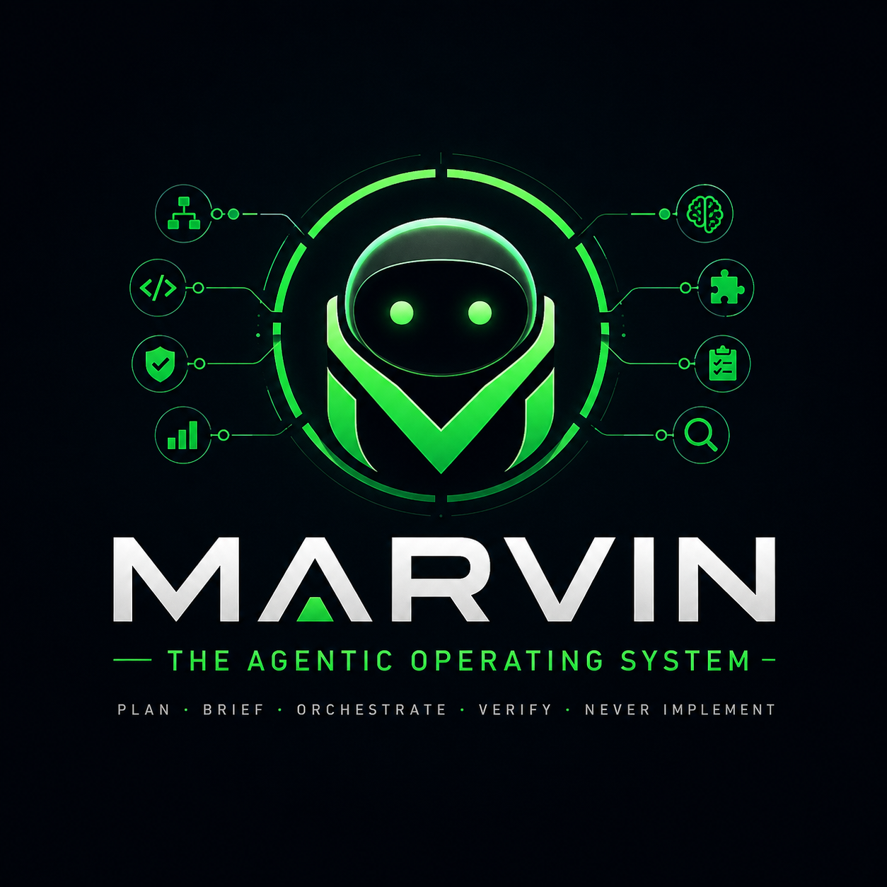

# Marvin — The Agentic Operating System

<p align="center">
  
</p>

## ✨ At a glance

> **Give your AI software team an operating system — not another enormous prompt.**

| 🧠 **Marvin at the helm** | 🧭 **Fits your workflow** |
|---|---|
| A sharp, evidence-hungry orchestrator that plans, delegates and verifies — but never disappears into a bulk implementation. | Installs a lean, self-contained payload in any repo and works with **Linear, Jira, GitHub Issues or Local** tracking. |

| 🧰 **Ready to ship** | 🧪 **Built under pressure** |
|---|---|
| **13 skills + 2 commands** cover setup, upgrades, reporting, docs, stress testing, kit validation, clean-up, the Codex handover and fleet mode. | Proven across a 7-milestone SaaS build: **37 agent-built tasks**, each independently validated. |

<p align="center"><sub>✦ Self-hosting: Marvin is built and operated under the same rules it installs. ✦</sub></p>

**Marvin** is a reusable agentic operating system for AI-assisted software projects. Install it into a repo and that repo gets an orchestrator with a name, a personality and a memory — one who plans, briefs specialised sub-agents, sequences their work and verifies it, but never bulk-implements. It is for anyone running real software delivery through Claude Code and tired of "done" without evidence. [What Marvin is](https://zenosyne-technologies.github.io/agent-operating-kit/) has the full picture.

# Contents

- [At a glance](#-at-a-glance)
- [Install](#install)
- [Documentation](#documentation)
- [Contributing](#contributing)
- [Inventory](#inventory)
- [License](#license)

## Install

Marvin is served by the standalone **emprove** marketplace ([Zenosyne-Technologies/emprove-marketplace](https://github.com/Zenosyne-Technologies/emprove-marketplace)):

```bash
claude plugin marketplace add Zenosyne-Technologies/emprove-marketplace
claude plugin install marvin@emprove
claude plugin install token-telemetry@emprove   # optional cost-telemetry companion
```

Then, in a project folder, run `/marvin:install-agent-os` (or just ask: "install the agent operating kit into this project"). [Getting started](https://zenosyne-technologies.github.io/agent-operating-kit/start.html) walks through the first session, the PM tool choice, installing without the plugin, upgrading and Windows.

## Documentation

The docs site explains how Marvin works: **[https://zenosyne-technologies.github.io/agent-operating-kit/](https://zenosyne-technologies.github.io/agent-operating-kit/)**

- [Getting started](https://zenosyne-technologies.github.io/agent-operating-kit/start.html): install, the first session, PM tools, installing without the plugin, upgrading, the plugin's hooks, Windows
- Concepts: [the task lifecycle](https://zenosyne-technologies.github.io/agent-operating-kit/concepts/lifecycle.html), [sizing](https://zenosyne-technologies.github.io/agent-operating-kit/concepts/sizing.html), [escalation](https://zenosyne-technologies.github.io/agent-operating-kit/concepts/escalation.html), [around the loop](https://zenosyne-technologies.github.io/agent-operating-kit/concepts/around-the-loop.html), [fleet mode](https://zenosyne-technologies.github.io/agent-operating-kit/concepts/fleet.html), [CodeGuard rules](https://zenosyne-technologies.github.io/agent-operating-kit/concepts/codeguard.html)
- [Settings](https://zenosyne-technologies.github.io/agent-operating-kit/settings.html): every `.marvin/PROJECT-INFO.md` key
- [Skills & commands](https://zenosyne-technologies.github.io/agent-operating-kit/skills.html): every skill and command the plugin ships
- [Reference](https://zenosyne-technologies.github.io/agent-operating-kit/reference.html): every guide in the installed cascade
- [Mods](https://zenosyne-technologies.github.io/agent-operating-kit/mods/index.html): what Marvin shows you in Claude Code
- [Releases](https://zenosyne-technologies.github.io/agent-operating-kit/releases/index.html): every version, its upgrade steps and its changes

The site is built from `site/` into `docs/` by `scripts/build-docs.sh`; see [Contributing](#contributing).

<!-- Maintainers: the inventory check in scripts/validate-kit.sh scans lines that are exactly three backticks, so the fence style used in this README is load-bearing. Re-run the gate after adding or removing any code block here. -->

## Contributing

`templates/` is the payload that gets installed into consumer projects; everything else — skills, commands, upgrade notes, the plugin manifest, this README — is kit machinery. Never blur the two: a change that helps one specific project belongs in that project's installed files, and only lessons that generalise get promoted into templates. `CLAUDE.md` holds the full extension rules — new activity docs, new tracker support, template line budgets, and the version and changelog bumps each change owes.

**This repo runs on the gitflow model its own payload ships** — `templates/marvin/agents/git-strategy.md` is the single owner of that model (branch table, tagging authority, semver, the release cut); it is not restated here. Concretely: `feature/AOS-<n>-slug` branches cut from `develop`, and the version bump plus annotated tag land on the `release/<version>` branch's cut to `main`. The factory is not self-installed, so it has no `.docs/` — its own release notes mirror the payload convention one level up, at `docs/release-notes/v<version>.md`, header contract and all; that file IS the annotated tag's message, and `scripts/validate-kit.sh` fails the release without it.

**Tags start at v0.22.0.** All 21 minor versions released through v0.21.0 shipped untagged — this repo has no git tags at all before that. Rather than fabricate history now (a tag's creation date can't be backdated honestly, and there is no `.docs/release-notes/` prose for those versions to serve as the tag message `git-strategy.md` requires — only the terse mechanical `upgrades/v*.md` deltas), tagging begins clean with the first release cut under this process. A retroactive backfill from `upgrades/v*.md` and the merge commits remains possible later, but deliberately isn't part of adopting gitflow — it would be its own tracked, reviewed piece of work, not a side effect of this one.

**The docs site is built, not hand-edited.** Its sources live in `site/`, with the page registry in `site/pages.json`; the Releases, Settings, Skills & commands and Reference pages are generated from the repo itself. Edit the source, run `bash scripts/build-docs.sh` and commit `docs/` with the change. `bash scripts/build-docs.sh --check` (validate-kit `docs-site`) fails on any stale, missing or orphan output. Screenshots follow `docs/images/README.md`.

Every PR must pass the static release gate and the twenty test suites, all of which CI runs on every push to `main`, `develop` and `release/**`, and on every pull request:

```
bash scripts/validate-kit.sh
bash scripts/test-migrations.sh
bash scripts/test-session-hook.sh
bash scripts/test-context-budget.sh
bash scripts/test-claude-md-split.sh
bash scripts/test-whats-new.sh
bash scripts/test-worktree-sweep.sh
bash scripts/test-worktree-mark.sh
bash scripts/test-runs-sync.sh
bash scripts/test-docker-sweep.sh
bash scripts/test-hook-lib.sh
bash scripts/test-update-gate.sh
bash scripts/test-subagent-hooks.sh
bash scripts/test-brief-lint.sh
bash scripts/test-docker-lint.sh
bash scripts/test-ticket-lint.sh
bash scripts/test-style-plugins.sh
bash scripts/test-codex.sh
bash scripts/test-codeguard.sh
bash scripts/test-placeholder-check.sh
bash scripts/test-build-docs.sh
```

The static gate's twenty-seven checks: known placeholders only · template line budgets · manifests parse and the version is semver · the label registry's header matches its newest changelog row · this README's inventory matches the tracked payload in both directions · every tracker folder ships its full file set · no plugin-root references leak into the payload · the current version's upgrade notes exist · every consumer-bound template document carries its standard's header keys (`doc-headers`, fail-by-default) · the repo's own release note for the current version exists with a valid header and a scope that resolves to at least one issue key · the `.docs/` estate is self-contained — nothing under `templates/docs/` references `.marvin/` or names Marvin (`docs-self-contained`, fail-by-default) · no tracked file embeds a contributor's local home path — `/Users/<name>` or `/home/<name>` (`no-local-paths`, fail-by-default) · concrete model names appear in no template outside `model-profile.md` and `model-profile-codex.md` — whole-word, case-insensitive, plus `gpt-<digit>` anywhere (`model-names`, fail-by-default) · the kit core carries only upgrade-renderable placeholders and imports nothing, and the `CLAUDE.md` stub carries no kit rule and ends with the bare import (`kit-core-split`) · every shipped persona in `agents/` is in the install skill's persona list and is a legal `relevance:` value (`personas`) · `CHANGELOG.md` carries the current version's section, in the six fixed categories, one-line bullets only (`changelog`) · the user-update rules block is defined once and the Marvin output style embeds it verbatim (`style-sync`) · every hook script is registered under its event, the sub-agent hooks scoped to `^marvin:`, the brief lint to the Agent tool, the Docker lint to Bash and the ticket lint to the tracker-write tools (`hooks-registered`) · the hook library's default context window equals the orchestrator window of every profile table in the model profile (`profile-window`) · every profile table in the model profile has the same column header and the same five tier rows (`profile-parity`) · the briefing template carries the per-session run layout literal the run-state hook gates on (`runs-layout`) · the briefing's prune allowlist quotes the hook library's session and key regexes verbatim (`run-patterns`) · every routed fleet event carries its `**E-<event>**` tag exactly once in both `fleet.md` and `fleet-child.md`, and the two guides' tag sets are equal (`fleet-pairs`) · the free-text `PROJECT-INFO.md` keys are quoted scalars (`frontmatter-quoting`) · every `claude plugin marketplace add` of a Zenosyne-Technologies repo names the emprove marketplace (`marketplace`) · the CodeGuard grading sentence is byte-identical in `codeguard.md`, the security stage of `validation-agent.md` and the Codex security lane (`codeguard-grading`) · the GitHub Pages site in `docs/` is exactly what `site/` builds to, with no stale, missing or orphan output (`docs-site`, via `scripts/build-docs.sh --check`).

## Inventory

```
README.md                          this file
BOOTSTRAP.md                       pointer prompt at the install skill (plugin-less environments)
CHANGELOG.md                       categorised per-release briefs (Action needed · Added · Changed · Fixed · Removed · Security), newest first — read by /marvin:whats-new
hooks/*.json                         hook registration — SessionStart runs marvin-session-start.sh, marvin-runs-sync.sh --session-start, marvin-worktree-sweep.sh --hook and marvin-docker-sweep.sh --hook; PostToolUse (Write|Edit|MultiEdit) runs marvin-runs-sync.sh --post-tool; PostToolUse + UserPromptSubmit run marvin-context-budget.sh; UserPromptSubmit + Stop run marvin-update-gate.sh; Stop runs marvin-runs-sync.sh --stop; SubagentStart/SubagentStop (^marvin:) run marvin-subagent-rules.sh / marvin-subagent-gate.sh (+ marvin-worktree-mark.sh --subagent-stop and marvin-runs-sync.sh --subagent-stop); PreToolUse (Agent|Task) runs marvin-brief-lint.sh; PreToolUse (Bash) runs marvin-docker-lint.sh; PreToolUse (tracker-write MCP tools|Bash|Write) runs marvin-ticket-lint.sh
scripts/marvin-session-start.sh      SessionStart hook body: version-drift check + the user-update rules block (only when the Marvin output style is not in effect), silent no-op outside a Marvin project
scripts/test-session-hook.sh         fixture-per-guard test suite for the SessionStart hook, incl. inline mutation checks (CI runs it too)
scripts/marvin-context-budget.sh      PostToolUse + UserPromptSubmit hook body: the context ladder (70/80/90 % of the compaction window) and the 400k/700k budgets, the stricter speaking; never blocks, silent outside a Marvin project
scripts/test-context-budget.sh       behavioural tests for the context-budget hook, incl. an inline mutation section (CI runs it too)
scripts/validate-kit.sh              twenty-seven-check static release gate (CI runs it on every PR)
scripts/migrate-v<version>.sh        executable layout migration — moves and stages files, prints a rename map, never edits content
scripts/test-migrations.sh           fixture-per-guard test suite for the migration scripts (CI runs it too)
scripts/mutate-migrations.sh         mutation harness — reverts one guard at a time and requires its fixture to fail
scripts/plan-claude-md-split.sh      read-only planner for the one-time v0.33.0 split — classifies each project-file line kit / near-kit / review / attribution / title / project
scripts/claude-core-history/        every always-loaded core the kit shipped at a tag (v0.22.0–v0.32.0) — the planner's reference set
scripts/test-claude-md-split.sh      planner fixtures P1–P8 plus inline mutation checks (CI runs it too)
scripts/whats-new.sh                 read-only aggregator: merges CHANGELOG.md briefs over a version range by category, Action needed first (backs /marvin:whats-new)
scripts/marvin-worktree-sweep.sh     removes the Marvin-marked finished agent worktrees under .claude/worktrees/ unless a scope check or one of nine keep guards (G1–G9) holds; backs the SessionStart sweep and /marvin:clean-worktrees (`worktree_sweep` on | check | off); `--at-risk` reports G8/G9 on every worktree, marked or not, and removes nothing
scripts/test-whats-new.sh            fixture suite for the aggregator, incl. inline mutation checks (CI runs it too)
scripts/test-worktree-sweep.sh       fixture suite for the sweep, incl. inline mutation checks (CI runs it too)
scripts/marvin-worktree-mark.sh      writes the Marvin-owned marker (git admin dir `marvin-owned`) for a marvin:* agent's isolation worktree on SubagentStop, or by hand for one the orchestrator made
scripts/test-worktree-mark.sh        fixture suite for the marker, incl. inline mutation checks (CI runs it too)
scripts/marvin-runs-sync.sh          SessionStart / PostToolUse (Write|Edit|MultiEdit) / SubagentStop / Stop hook body: carries run state from a session's checkout to the project's per-session run folder `.marvin/runs/<UTC start>-<session id>/` (symlink-refusing, git-ignored)
scripts/test-runs-sync.sh            fixture suite for the run-state sync, incl. inline mutation checks (CI runs it too)
scripts/marvin-runs-migrate.sh       moves a flat `.marvin/runs/<KEY>/` run folder into one legacy session folder (run by the upgrade skill's readiness step 6b; `--check` first; moves files, never edits content)
scripts/marvin-docker-sweep.sh       removes throwaway Docker resources of finished agent worktrees behind eight keep guards (D0–D7) (backs the SessionStart Docker sweep and /marvin:clean-worktrees)
scripts/test-docker-sweep.sh         fixture suite for the Docker sweep against a fake docker, incl. inline mutation checks (CI runs it too)
hooks/user-update-rules.txt          the user-update rules block, defined once — printed by the SessionStart hook, embedded by the output style
hooks/style-plugins.txt              registry of plugins that inject a competing output style (install/upgrade offer to disable them per user)
output-styles/marvin.md              the Marvin output style (marvin:marvin), selected per project by outputStyle
scripts/lib/marvin-hook-lib.sh       shared hook library — bounded streaming JSON walker, transcript readers, window resolution and level ladder, the effective `enabledPlugins` reader (`mh_enabled_plugins`)
scripts/test-hook-lib.sh             unit suite for the hook library, incl. inline mutation checks (CI runs it too)
scripts/marvin-update-gate.sh        UserPromptSubmit + Stop hook body: the user-update format gate (advise / block / off)
scripts/test-update-gate.sh          behavioural suite for the update gate, incl. inline mutation checks (CI runs it too)
scripts/marvin-subagent-gate.sh      SubagentStop hook body: the marvin:* FINAL MESSAGE contract gate
scripts/marvin-subagent-rules.sh     SubagentStart hook body: the constant marvin:* rules block
scripts/test-subagent-hooks.sh       behavioural suite for both sub-agent hooks, incl. inline mutation checks (CI runs it too)
scripts/marvin-brief-lint.sh         PreToolUse hook body: brief lint for marvin:* dispatches plus the wind-down context line
scripts/test-brief-lint.sh           behavioural suite for the brief lint, incl. inline mutation checks (CI runs it too)
scripts/marvin-docker-lint.sh        PreToolUse (Bash) hook body: Docker lint — advice on unlabelled Docker resources, compose without -p, throwaway MySQL/MariaDB with binary logging on
scripts/test-docker-lint.sh          behavioural suite for the Docker lint, incl. inline mutation checks (CI runs it too)
scripts/marvin-ticket-lint.sh        PreToolUse (tracker writes) hook body: ticket lint — required dimensions, registry values, size/severity only in prose (ticket_lint block / advise / off)
scripts/test-ticket-lint.sh          behavioural suite for the ticket lint, incl. inline mutation checks (CI runs it too)
scripts/marvin-style-plugins.sh      read-only finder of enabled competing style plugins (run by install/upgrade)
scripts/test-style-plugins.sh        fixture suite for the finder, incl. an inline mutation check (CI runs it too)
scripts/build-docs.sh               builds the GitHub Pages site in `docs/` from `site/` (`--check` verifies it is fresh; the `docs-site` gate runs it)
scripts/lib/build_docs.py          the docs-site generator: markdown subset renderer, page registry, shell, build and `--check`
scripts/test-build-docs.sh         behavioural suite for the generator, incl. mutation checks (CI runs it too)
site/                              docs-site sources: the page registry, the HTML shell, page bodies, `assets/` (output is committed in `docs/`)
scripts/marvin-codex.sh              the only door to the Codex companion (codex-companion.mjs): locates it; `check` (is Codex usable?) answers with one status line; `run <lane>` submits one guarded lane job (handover, astra, effort ceiling, write-evidence only on review/security) and waits under a wall-clock budget; `result <id>` resumes a pending job
scripts/test-codex.sh                fixture suite for marvin-codex.sh with a fake node on PATH (CI runs it too)
scripts/marvin-codeguard.sh          read-only CodeGuard install/enable check — `ready` / `disabled` / `not-installed` / `error <reason>` (run by the install and upgrade skills)
scripts/test-codeguard.sh            fixture suite for it, incl. an inline mutation check (CI runs it too)
scripts/marvin-placeholder-check.sh  read-only check that no install-time {{PLACEHOLDER}} is left in the installed kit files (run by install/upgrade as their last check)
scripts/test-placeholder-check.sh    fixture suite for it: the real templates rendered, each leftover form, scope and symlink cases, inline mutations (CI runs it too)
upgrades/v*.md                     per-release consumer-visible upgrade steps — the upgrade skill walks them in order
agents/*.md                        Marvin's fifteen sub-agent personas, shipped with the plugin (marvin:* namespace, tier-bound models) — incl. validator-visual, the micro-tier developer-micro, the five escalation rungs (escalation-small-xhigh, -high, -xhigh, -max, -frontier) and the Codex forwarder codex
commands/*.md                      two commands: /marvin:info (state report) and /marvin:play (bounded play scenario dispatcher)
scenarios/*.md                     the shared bounded-execution contract plus six scenarios: research-solo, research-deep, quick-fix, taskforce, bug-hunt, visual-sweep
templates/
  CLAUDE.project.md                consumer-owned stub that seeds the project's root instructions file — facts, project rules, the bare kit-core import last
  settings.json                    attribution policy for commits/PRs — ships the "Emprove Marvin (Claude)" branded trailer; install blanks it to disable, or skips it to keep default
  marvin/
    CLAUDE.marvin.md               kit-owned always-loaded core rules (installed to .marvin/, imported by the project file, refreshed on upgrade)
    PROJECT-INFO.md                project meta page — YAML frontmatter machine contract + human body (installed to .marvin/PROJECT-INFO.md)
    MEMORY.md                      Marvin's self-managed project-memory skeleton (installed to .marvin/MEMORY.md)
    LICENSE                        self-scoped PolyForm Noncommercial notice for the kit files (installed to .marvin/LICENSE)
  marvin/agents/
    briefing.md                    how to write any sub-agent brief
    document-standard.md           document header keys, index-row format, and the .docs/ crawl protocol
    git-strategy.md                the single source of truth for git — gitflow branches, tagging authority, semver, the release cut
    escalation.md                  round signals — converging, stuck, whack-a-mole, bloat, loop, cost blowout — their precedence, the round cap, and the Rethink step
    escalation-ladder.md           the escalation climb — micro → small tier-up, the small tier's xhigh rung, then high → xhigh on the heavy tier's model → the ask-at-max gate (max recommended, frontier opt-in in the `opus` profile, `max` only in `fable`) → stop at the user
    model-profile.md               the version's two model profiles (`opus` default, `fable`) — tier → concrete model → context window → default effort each — the profile-dependent Phrases, shared model-specific rules, per-profile validated-set statement
    model-profile-codex.md         the Codex lanes' profile — tier → Codex model → default effort per lane, the Astra and effort-ceiling rules, validated-set statement (read by marvin-codex.sh)
    session-budget.md              how long a session runs — the 400k / 700k budgets, the 70 / 80 / 90 % context ladder, the stop-and-compact nudge, the handoff
    guardrails.md                  the DO NOT framework — four dispositions, the escalation chain, a generic baseline table, per-persona additions
    information-guide.md           the dynamic rule system — what earns a file, tagging, index, briefing duty, lifecycle
    information-severity.md        the four severity levels, their reading obligations, and the severity × relevance matrix
    label-syntax.md                versioned label registry (dimensions incl. sizing, backfill rule, changelog)
    planning-research.md           size-gated planning: size:m build decomposition, size:m+ brief falsifier, size:l/xl plan-validation + solution research
    validation-agent.md            BA + security validator personas, E2E hook
    visual-validation.md           visual/design validator persona — surface resolution, capture + degradation ladder, generic design checklist, severity, reporting
    codex.md                       Codex handover — consent switch, validation strategies and lanes, four-eye verdict merge, auto-debug tollgates, the Codex build ladder, fallback
    codex/                         the six Codex lane briefs, each a self-contained Codex prompt ending in its pinned JSON output: plan.md review.md security.md design.md diagnose.md build.md
    documentation-agent.md         post-task documentation scope
    ticket-filing.md               tracker filing rules (defers to the in-tracker guide)
    ponytail.md                    small-model micro-task profile
    reporting.md                   collect-once render-many report definitions (digest, close-out, stakeholder)
    security.md                    secrets, dependency vetting, and security-surface discipline
    codeguard.md                   CodeGuard rules on top of the kit checklist when security_rules: codeguard — availability, rule selection, builder and validator use, the Codex lane's Rules block, grading, license
    token-economics.md             telemetry contract — cost queries, pricing rule, context sidecar
    worktrees.md                   agent worktree location, push cadence, the sweep's when/what, WORKTREE: handover line
    session-recovery.md            the session's worktree vanished mid-task — recreate from its branch, re-check the branch, confirm run state in the project, never mark, report
    fleet.md                       fleet master — program plan and decision log, leases, starting and locking a child, doorbells and the board, the receiving half of every routed event, epic merges, successors
    fleet-child.md                 fleet child — the doorbell line, the sending half of every routed event, relay verification, shared files, the compaction budget, the epic merge gate
    tidying.md                     Docker labels, naming, who removes what and when, the backstop sweep, binary logging off for throwaway databases
    user-updates.md                orchestrator-to-user message formats — emoji legend, shipped table, issue callout, Next / Open questions tail
    handbooks.md                   three-audience Obsidian handbook system — page format, discovery by sources, index rule
  docs/                            the .docs/ taxonomy seeds — every folder gets one lowercase index.md
    index.md                       root index: crawl entry point, sub-folder table, where-a-new-document-goes rule
    plans/index.md                 decided work not yet finished
    researches/index.md            what investigations established
    refactor/index.md              identified technical debt and the cleanup it calls for
    future/index.md                deliberately deferred ideas
    information/index.md           the project's dynamic rule system (adds severity + relevance columns)
    handbooks/index.md             handbooks parent index: the three audience sub-folder rows
    release-notes/index.md         one document per released version, mirroring that version's annotated tag
    handbooks/audience-index.md    generic handbook ToC skeleton (installed ×3 as developer|user|admin/index.md)
    handbooks/developer/screens/index.md  screen catalog — the declared UI surfaces (route, how to reach, breakpoints) the design/visual review resolves against
  pm/
    INSTALL.md                     factory-side PM subsystem reference: selection, sensecheck, project-key flow (NOT installed)
    linear/
      intake-structure-brief.md    agent brief that creates labels + intake guide
      tracker-config.md            4/4 levels native; severity → Linear Priority
      stats-collection-brief.md    label-dimension stats snapshot (schema v4, tokens section with its state) to .marvin/reports/
    jira/
      intake-structure-brief.md    agent brief that seeds the label taxonomy + intake guide
      tracker-config.md            3/4 levels + virtual-milestone rule; severity → Jira Priority / JSM Impact
      convert-milestones-brief.md  dispatchable when the v2 connector adds release creation: milestone labels → releases
      stats-collection-brief.md    label-dimension stats snapshot (schema v4, tokens section with its state) to .marvin/reports/
    github/
      intake-structure-brief.md    agent brief that seeds labels via gh CLI + a pinned intake guide issue
      tracker-config.md            4/4 levels native; no priority/estimate field to mirror
      stats-collection-brief.md    label-dimension stats snapshot (schema v4, tokens section with its state) to .marvin/reports/
    local/
      intake-structure-brief.md    agent brief that scaffolds .docs/project-management/ + a file-local intake guide
      tracker-config.md            4/4 levels via files; labels in frontmatter, no native fields to mirror
      stats-collection-brief.md    label-dimension stats snapshot (schema v4, tokens section with its state) to .marvin/reports/
```

## License

Marvin — The Agentic Operating System is **dual-licensed**.

**Non-commercial use is free.** Use, modify, and share the kit under the [PolyForm Noncommercial License 1.0.0](LICENSE) for any noncommercial purpose — personal projects, study, research, and use by nonprofits, educational institutions, and government bodies, as the license spells out. Because Marvin copies its `templates/` payload into the projects it sets up, those installed files carry the same license.

**Commercial use requires a commercial license.** Any commercial purpose — including use inside a business, even internally — needs a separate commercial license from the copyright holder, Emprove Services Kft. (maintained by Zenosyne Kft.). To arrange one, open an issue on this repository titled **"Commercial license"** and we'll follow up.

This is a *source-available* license, not an OSI-approved open-source one: it deliberately restricts commercial use, and the copyright holder retains all commercial rights. Contributions are welcome under the terms in [CONTRIBUTING.md](CONTRIBUTING.md).
